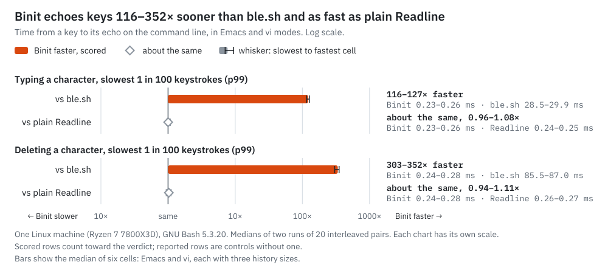
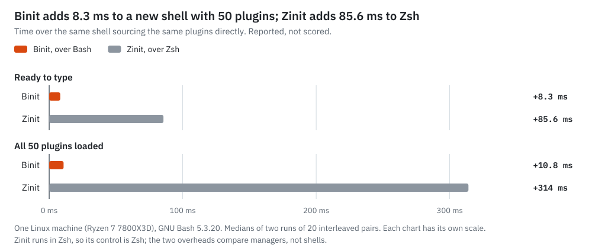

# Binit

Binit runs the plugins in your interactive Bash from a pinned, verified
snapshot and loads each one when it is needed. It also draws a completion
menu, history search and suggestions inside Bash itself, so the line you are
typing never waits on a slow plugin or completion.

<picture>
  <source media="(prefers-color-scheme: dark)" srcset="docs/images/startup-dark.svg">
  
</picture>

Binit, Bash-it and Oh My Bash load the same 50 plugins on one Linux machine, and a plain `.bashrc`
that sources them directly is the control. [Performance](#performance) covers typing and
completion, and the [publication scoreboard](docs/publication-scoreboard.md) describes the method and
the verdict rules. Every number comes from the timing archive attached to each
[release](https://github.com/exochard/binit/releases).

## Install

Binit 0.1 runs on Linux x86_64 with glibc 2.39 or newer and GNU Bash 5.2 or
later. Download the archive and `SHA256SUMS` from the
[latest release](https://github.com/exochard/binit/releases/latest), then:

```bash
sha256sum -c SHA256SUMS --ignore-missing
tar -xzf binit-0.1.0-linux-x86_64.tar.gz
cd binit-0.1.0-linux-x86_64
python3 -I install.py --binary "$PWD/bin/binit"
```

The installer puts `binit` in `~/.local/bin` and prints the line to add to
`~/.bashrc`. It edits no startup file unless you pass `--rc-file`. Your system
shell stays as it is. [Installation](docs/install.md) covers source builds and
`--uninstall`.

## Declare plugins

Plugin lines go in `~/.bashrc`, after the init line:

```bash
eval "$(binit init)"
binit plugin user/repo ver=v1.2.0 files=init.bash       # a GitHub repository, pinned
binit plugin ~/src/tool load=command commands=tool      # loads on first use of `tool`
binit plugin ~/src/nvm id=nvm load=wait                 # loads right after the first prompt
```

Run `binit sync`, then `exec bash`. Sync fetches each source, pins it to a full
commit or checksum, and publishes a new generation with every file listed by
digest. A shell checks that generation before sourcing anything and never
touches the network at startup. Existing shells keep the code they started
with.

A plugin loads at startup, at the first prompt, right after the prompt appears,
on first use of a command or completion, on a timer, on an event or when a
watched file changes. Existing functions and aliases keep precedence.
[Plugin interface](docs/plugins.md) lists every source type and key;
[loading and shell effects](docs/runtime-features.md) covers scheduling and
unload.

## Complete and search

Tab opens a menu of Bash's own completions. Arrows, hjkl, Tab and Shift-Tab
move through it, `/` filters, Enter inserts and Esc cancels. As you type, the
newest matching history entry appears as a dim suggestion; Right, Ctrl-F or
End accepts it. Ctrl-R searches history and Enter inserts the match without
running it. Ctrl-Backspace deletes the previous word.

A completion that takes long can run in a separate process: typing cancels it
and the line stays responsive. See [isolated completion
providers](docs/completion-providers.md). `binit completion off` returns the
current shell to Readline's ordinary completion.

The built-in editor module targets Bash 5.3 with Readline 8.3. Other supported
Bash versions keep Readline's completion and the rest of Binit.
[Editing](docs/editor.md) and [history](docs/history.md) list every key.

## Update and recover

```bash
binit update --check     # show what would move, change nothing
binit update             # move Git pins to the commits their ver names
binit rollback           # use the previous generation in new shells
binit profile            # load and hook time per plugin
BINIT_SAFE=1 bash        # a shell that skips Binit entirely
```

A failed sync leaves the current generation in place. [Candidate
checks](docs/candidate-checks.md) run your own tests against a prepared
generation before any new shell uses it.

## Performance

Typing and completion are compared with ble.sh, which also draws its own completion menu inside
Bash, and with plain Readline as a control. Every value comes from the release binary on one Linux
machine (Ryzen 7 7800X3D, GNU Bash 5.3.20) and averages two runs of 20 interleaved pairs. Editor
values are the median of six cells: Emacs and vi, each with three history sizes.

<picture>
  <source media="(prefers-color-scheme: dark)" srcset="docs/images/typing-dark.svg">
  
</picture>

<picture>
  <source media="(prefers-color-scheme: dark)" srcset="docs/images/completion-dark.svg">
  
</picture>

<picture>
  <source media="(prefers-color-scheme: dark)" srcset="docs/images/menus-dark.svg">
  
</picture>

<picture>
  <source media="(prefers-color-scheme: dark)" srcset="docs/images/overhead-dark.svg">
  
</picture>

### Where Binit is slower

- A `~/.bashrc` that sources the same 50 plugins directly is ready to type 8.4 ms sooner (14.0 ms
  against 22.4 ms). That is the cost of Binit's runtime, which checks the generation before
  sourcing anything. Zinit adds 87.2 ms over Zsh doing the same.
- Putting every plugin on `load=wait` makes the shell ready to type 4.8 ms later than loading them
  at startup (27.2 ms against 22.4 ms).
- Plain Readline returns after a cancelled 1,024-item completion 5.5 to 5.7 times sooner (2.4 to
  2.5 ms against 13.7 to 13.8 ms).
- A completion that has to run inside the shell takes as long as with plain Readline, and accepting
  it takes 0.34 to 0.38 ms against 0.26 to 0.29 ms.

### Not measured yet

- Compatibility with unmodified popular plugins. A development run passed the same four
  (bash-completion, fzf, Git completion and nvm) under Binit, Bash-it and Oh My Bash; it is not
  release evidence.
- Other machines, ARM64, and the time a terminal takes to draw.

## Limits

- Linux x86_64 only in 0.1.
- Plugins are Bash code with your shell's full authority. Pins and digests
  detect changed files; they do not vouch for an author.
- `binit unload` removes the functions, aliases, completions and prompt
  segments a plugin added, if they are unchanged. Variables, exports and other
  side effects stay.
- `binit run --engine` selects an experimental Bash build. It has not met its
  25% speed target, so `binit run` uses `/bin/bash` by default.

## Project

Binit is vibe-engineered: it is written with AI coding agents, and every
change lands with the tests and measurements behind it. The
[documentation](docs/README.md) explains how it works.
[CONTRIBUTING.md](CONTRIBUTING.md) has the build and test setup, and
[SECURITY.md](SECURITY.md) explains how to report a vulnerability.

Binit's original code is under the [MIT license](LICENSE). GNU Bash and
Readline keep their GPL terms; [licensing](docs/licensing.md) explains what
each release archive contains.
