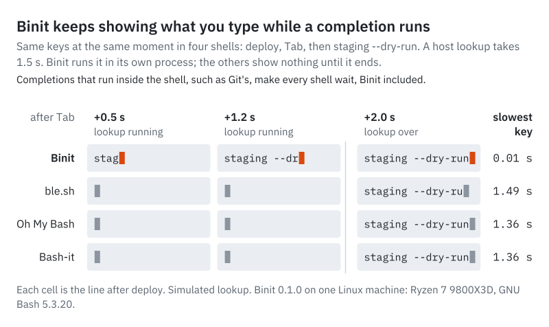

# Why a slow completion freezes your prompt

Press Tab after a command whose completion has to look something up, such as a
cluster, a cloud account or a long host list, and Bash stops echoing keys until
the lookup returns. The keys you type meanwhile are not lost. They wait in the
terminal and appear all at once when the completion ends. This page explains
where that pause comes from, measures it in four shells, and describes how
Binit avoids it for completions that can run as a separate program.

## Where the time goes

Bash's programmable completion calls a shell function, registered with
`complete -F`, inside the interactive shell. Readline, the line editor Bash
uses, waits for that function to return before it reads the next key. The
kernel keeps buffering what you type, but nothing draws it until the function
ends.

Bash-it and Oh My Bash add completion scripts on top of the same mechanism, so
they pause the same way. ble.sh replaces Readline with its own editor written
in Bash. It still runs the completion function inside the shell, and it waits
for it too.

## Measured

Four shells received the same keys at the same moment through tmux:
`deploy`, Tab, then `staging --dry-run`. The completion for `deploy` sleeps
for 1.5 s before it answers, standing in for a network lookup. A script read
each shell's command line every 11 ms and recorded when every typed character
first appeared.

<picture>
  <source media="(prefers-color-scheme: dark)" srcset="images/filmstrip-dark.svg">
  
</picture>

| Shell | Slowest key after Tab |
| --- | --- |
| Binit 0.1.0 | 0.10 s |
| Oh My Bash, theme off | 1.35 s |
| Bash-it, theme off | 1.35 s |
| ble.sh 0.4 | 1.51 s |

In Oh My Bash and Bash-it the first key waited 1.35 s and the rest followed in
one burst. ble.sh also stopped again near the end: its automatic completion
called the lookup a second time when typing paused. In Binit sixteen of the
seventeen keys appeared within 10 ms. One space took 95 ms on every run, and
that cost is still being traced.

This run is a demonstration on one machine, Ryzen 7 7800X3D with GNU Bash
5.3.20. The scored benchmark uses a 200 ms provider over Emacs and vi modes and
three history sizes. There the slowest 1 in 20 keys took 2.0 ms in Binit,
200.1 ms with plain Readline and 224.8 ms with ble.sh. The
[publication scoreboard](publication-scoreboard.md) describes that method.

## Why the shell has to wait

A completion function may change the shell it runs in. It can set variables,
define functions, change directory or register further completions, and
bash-completion's lazy loader does exactly that the first time it sees a
command. Threads cannot run Bash code safely because they share the
interpreter's state. A forked copy of the shell could run the function, but its
changes would stay in the copy. So an ordinary completion function has to run
in the shell, and the shell has to wait for it.

## What Binit does instead

Binit treats a provider that only computes candidates from its input as a
separate program. You register it once:

```bash
binit completions register deploy /usr/local/bin/deploy-hosts
```

On Tab, Binit's completion function starts that program and passes the
request on a sealed standard input: the line, the cursor offset and the words
Bash split. It then waits in native code that watches the terminal without
reading from it. When a key arrives, Binit kills the worker and leaves the key
for Readline, so the line keeps moving. When the worker answers first, Binit
checks that the line, cursor, directory and loaded plugin generation are
unchanged, then hands the candidates to Readline, which inserts them with its
usual quoting.

The worker runs under a seccomp filter that refuses to create processes or
threads, so cancelling one process cancels the whole request. It also has a
2-second deadline, 2 seconds of CPU time, 256 MiB of address space and 1 MiB of
output. The [provider protocol](completion-providers.md) lists every field and
limit.

## Limits

Ordinary completion functions still run inside the shell. Git's completion and
the bash-completion collection pause Binit exactly as they pause every other
shell. Only registered providers get the separate process.

A provider must be a single program that reads its context from standard input
and writes NUL-terminated candidates. A shell script that runs other programs
does not qualify unless it replaces itself with one. The
[npm task example](../examples/plugins/npm-tasks/plugin.toml) shows a complete
provider.

The mechanism needs Linux for `close_range` and seccomp, and Binit 0.1 ships
for x86_64 only. A worker blocked in uninterruptible kernel I/O can outlive a
kill for a moment, so the cancellation target is a percentile over measured
cases, not a hard real-time bound.
